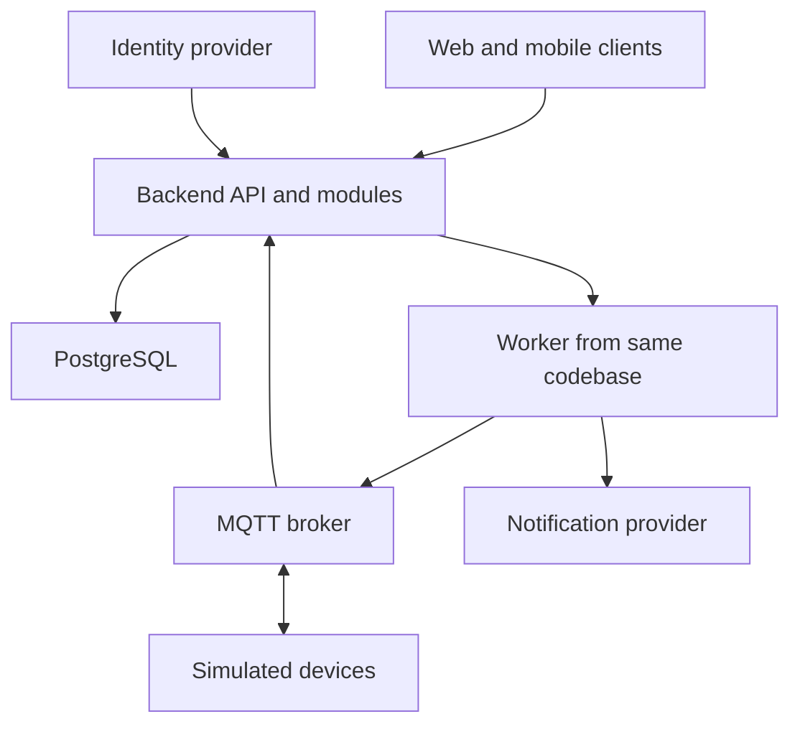

# Architecture A — modular monolith baseline

## Provenance

Prepared by Codex in ChatGPT Work using the section structure of the official [Spec Kit plan template](https://github.com/github/spec-kit/blob/main/templates/plan-template.md) and referring to its [planning workflow](https://github.com/github/spec-kit/blob/main/templates/commands/plan.md).

This is a template-guided draft. Specify CLI initialization, setup-plan, and the full Spec Kit workflow were not run. Step 3 of the assignment still needs an actual run and retained output.

## Summary

Use one backend application with separate identity/membership, device, command, event, notification, and audit modules. A shared relational database makes ownership checks and durable writes straightforward. A worker runs from the same codebase to deliver messages and notifications.

## Technical context

Proposed stack: TypeScript web/mobile clients and backend, PostgreSQL, an MQTT broker, and an external identity provider. Exact supported versions will be pinned during implementation. The web client can use React and the mobile client React Native. These are design choices, not installed dependencies.

Target: Linux container hosting, browser, Android/iOS client. Testing: module unit tests, API/database/broker integration tests, and end-to-end scenarios from the requirements. Scale and performance targets are in [requirements](01-requirements.md).

## Components

The worker reads durable outbox rows; the API does not rely on an in-memory task handoff. The arrow from API to worker represents this logical work flow.

## Command and event flow

1. Validate the caller's identity and membership for the device's home.
2. In one database transaction, store the command and an outbox entry. Return HTTP 202 and a command ID.
3. A worker claims an outbox row with a lease and publishes a command containing its ID and expiry time.
4. The simulated device rejects expired commands and remembers processed IDs. It acknowledges the same result for repeated IDs.
5. Persist acknowledgment and update authorized clients. A missing acknowledgment leaves the command expired/unknown, never falsely successful.
6. For telemetry, authenticate the device, validate its home/topic, deduplicate the event ID, and update state. Create notification work in the same transaction as the security event.

## Data and boundaries

Users are identified by identity-provider subject. Membership relates a user to a home and role. Devices belong to exactly one home. Commands belong to a device and include actor, requested action, status, expiry, and idempotency key. Events have a device-scoped unique ID, observed time, received time, and payload. Notification attempts and outbox records have separate retry states.

Modules access data through explicit service interfaces. Only the command module changes command state. Audit entries are append-only to normal application roles. Every home-scoped query includes the home boundary.

## Deployment analysis

For the demonstration, run API, worker, broker, and PostgreSQL as separate containers on one host; clients connect through HTTPS. This is inexpensive to operate but has a single-host failure risk.

For a production proposal, run multiple API instances, separately scaled workers, a managed database with backups, and a suitably available broker. Clients reconnect to streams and reload current state after a disconnect. Database migrations must remain compatible during rollout. Roll back application images if smoke tests fail; do not blindly reverse a destructive database migration.

CI should lint, test authorization and command handling, scan dependencies, build immutable images, and deploy to staging. After validation, deploy the same image to production. No deployment has been performed.

## Constitution check

| Principle | Design result |
|---|---|
| Small-team maintainability | One backend codebase and clear module interfaces. |
| Home isolation | Membership checks on API, stream, and device boundaries. |
| Reliable actuation | Durable outbox, expiry, device deduplication, explicit acknowledgment. |
| Testable requirements | Requirement IDs map to planned validation scenarios. |
| Honest evidence | Targets and deployment proposals are not presented as measured results. |

## Proposed project structure

Future implementation directories: web/, mobile/, backend/src/modules/, backend/src/worker/, backend/tests/, and deploy/. These directories are proposed; this repository currently contains documents only.

## Risks and tradeoffs

A backend defect can affect several features. Independent scaling of modules is limited. A shared database can become a bottleneck. Mitigate these with module boundaries, worker isolation, indexes based on measured queries, connection limits, and monitoring. Extract services only if measured load or team boundaries justify the additional complexity.
