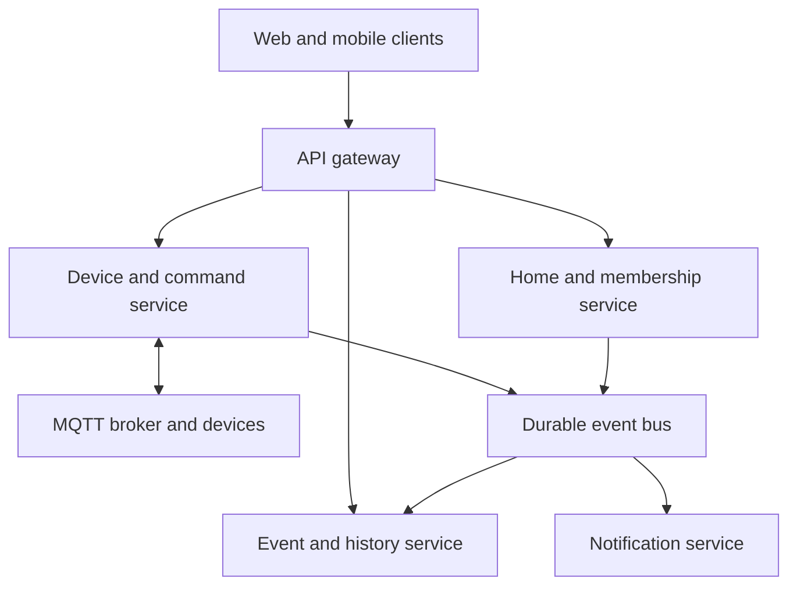

# Architecture B — independent services

## Origin and goal

Generated by Codex as an alternative to Architecture A, using the same requirements. This option prioritizes independent deployment and scaling.

## Structure

Each service owns its data store. An external identity provider authenticates users; the gateway checks tokens, and services still enforce authorization. Membership decisions for sensitive commands require a current authoritative check. If membership cannot be verified, reject the command rather than using stale permissions.

## Responsibilities and communication

The home service owns homes, roles, and memberships. The device service owns registration, command records, and acknowledgments. The event service owns telemetry history and read models. The notification service owns delivery attempts and preferences.

Use synchronous calls for commands that require an immediate permission decision. Publish versioned events for history and notifications. Each service uses a local transaction and outbox for durable event publication. Consumers deduplicate IDs. There is no assumption of an atomic transaction across databases.

An event contains event ID, schema version, home ID, device ID where applicable, source, timestamp, and correlation ID. Unrecognized versions are quarantined for investigation rather than silently discarded. Logs must not expose tokens or private event payloads.

## Consistency and failure handling

The command service is the source of truth for command status. History views may lag. The UI should query authoritative command status while a command is pending, and show when history is stale.

Delivery is treated as at least once. A retry never creates a fresh command ID. Devices reject expired requests and deduplicate repeated IDs. Poison messages go to a dead-letter queue after bounded retries; replay preserves the original ID. Notification failures do not block ingestion.

Revocation must disconnect existing streams and prevent new access. Cross-service membership caches require invalidation and bounded lifetimes; sensitive actions must not rely solely on them.

## Deployment analysis

Deploy each service as a separate container with independent release pipelines and health checks. Use managed databases, a durable message bus, MQTT infrastructure, and an identity provider. Start with a managed container platform; Kubernetes is not required.

Maintain a compatibility window for API/event schema changes. Deploy consumers that accept both old and new schema versions before producers emit a new version. Back up each owned store and test coordinated recovery; restoring one database may require replay and reconciliation.

Monitor per-service availability, queue lag, failed authorization, acknowledgment latency, duplicate processing, and notification delivery. Distributed tracing and correlation IDs are needed to investigate a command across services.

## Benefits and limitations

Benefits: event-heavy workloads can scale separately; service releases can be independent; notification failures can be isolated.

Costs: more databases and pipelines, network failure modes, eventual consistency, schema coordination, and harder testing. For the assumed student team and initial scale, these are significant costs without demonstrated need.

## Planned validation

Run all shared requirement tests. Additionally test a stopped event service, delayed membership updates, incompatible events, duplicate delivery, bus interruption, and partial restore. Verify no unauthorized actuation or duplicate logical alerts occur during recovery.
