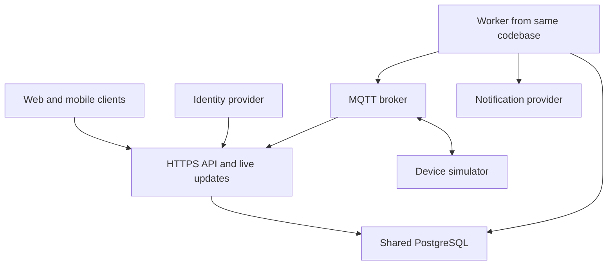

# HomeSecure — final architecture

## Decision and scope

Architecture A is selected: a modular monolith with one backend codebase and shared PostgreSQL database. The API and worker are separate processes built from that codebase. This keeps deployment manageable while separating background work from user requests. Architecture B remains the documented alternative.

This is a design for a simulated smart-home demonstration. It is not a deployed security system.

## Components

| Module | Responsibility | Owned records |
|---|---|---|
| Identity/membership | Token validation, home access, roles and revocation | Homes, memberships |
| Devices | Registration, credentials, telemetry and freshness | Devices, current state |
| Commands | Authorization, command lifecycle and expiry | Commands |
| Events | Deduplicated security events and history | Events |
| Notifications | Preferences and retryable delivery | Notifications, attempts |
| Audit | Durable record of user actions and outcomes | Audit entries |
| Outbox | Durable dispatch, leasing and retry | Outbox rows |

Modules expose service interfaces. Other modules do not directly change their owned records. Shared transactions may compose module operations through an application service; the database does not imply unrestricted cross-module writes.

## Trust boundaries

Clients are untrusted. Validate token signature, issuer, audience, and expiry using the selected identity provider, then enforce current membership for the requested home. Do not trust a home ID in the client payload as authorization.

Devices use distinct credentials and broker ACLs restricted to their registered home/device topics. Validate payload size, schema, event ID, and device identity before persistence. Database and broker administration remain on a private network. Secrets come from deployment configuration, never committed files.

Live streams are home-scoped. Recheck membership before each delivery and disconnect revoked users; do not authorize only at initial connection.

## Reliable command path

The API validates membership, device capability, and idempotency key. It commits a command, audit entry, and outbox row atomically, then returns 202. The worker leases the outbox row and publishes the original command ID and expiry.

The simulator rejects expired requests and persists processed IDs/results across restart. Retries retain the same ID. Transport acceptance does not mean device success. The matching device acknowledgment updates the authoritative command record; clients reload that record after reconnecting.

A lost acknowledgment can leave the physical result unknown. Late acknowledgments are retained as evidence without rewriting an expired command as an on-time success. Device telemetry separately reports current physical state.

## Event and notification path

Persist the event once using its device-scoped ID. Update current state only for newer device sequence numbers from the current registration epoch. A stale event may enter history but must not overwrite current state.

Create one logical notification per event/recipient/channel. Notification delivery uses bounded retries and records each attempt. Exactly-once external delivery is not guaranteed when a provider lacks idempotency support.

## Deployment and evolution

The demonstration uses one container host with API, worker, broker, and database, accepting a single-host failure risk. A production proposal can replicate API/worker processes and use managed database/broker services. Multiple workers require database-backed leases.

Extract a module into a service only when measured load or independent team ownership justifies it. Keep the initial implementation free of unnecessary cross-service transactions.

See [design](design.md), [requirements](requirements.md), and [deployment](deployment.md) for detailed contracts and verification.
