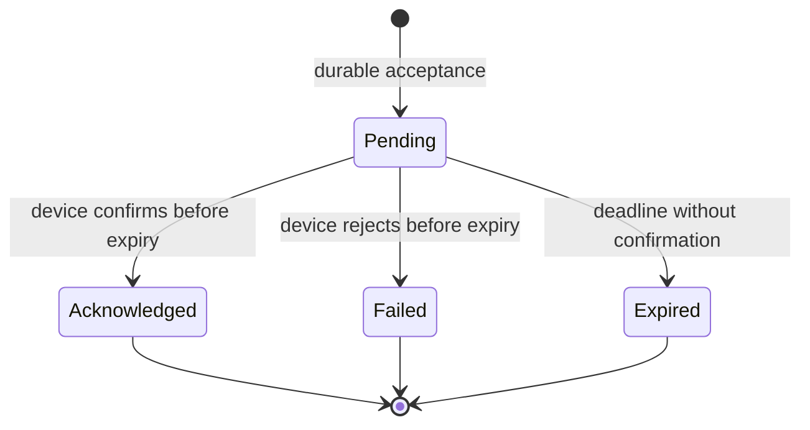

# HomeSecure — interface contracts


All endpoints require a bearer token. Every path homeId is checked against current membership. Return JSON errors as {"error":{"code":"CODE","message":"Readable explanation"}}. Lists use opaque cursor pagination, default limit 50 and maximum 100.

| Method and path | Input | Success |
|---|---|---|
| GET /homes/{homeId}/devices | Optional cursor, limit | 200 with items and nextCursor |
| POST /homes/{homeId}/devices/{deviceId}/commands | Idempotency-Key header; action JSON | 202 with command ID and pending status |
| GET /homes/{homeId}/commands/{commandId} | None | 200 with status and timestamps |
| GET /homes/{homeId}/events | Optional cursor, limit, type | 200 with items and nextCursor |
| GET /homes/{homeId}/stream | Authenticated live connection | Home-scoped event notifications; client refetches authoritative state |
| DELETE /homes/{homeId}/members/{subject} | Owner role | 204 after revocation; reject removing the final owner |

Example device response:
```json
{"items":[{"id":"device-id","type":"light","reportedState":{"power":"off"},"online":true,"lastSeenAt":"2026-11-06T02:00:00Z"}],"nextCursor":null}
```

Example command request, using Idempotency-Key: request-123:
```json
{"action":"setPower","parameters":{"power":"on"}}
```

Example accepted response:
```json
{"id":"command-id","status":"pending","expiresAt":"2026-11-06T02:00:30Z"}
```

IDs above are illustrative placeholders. Actual payload IDs must be valid UUIDs.

A repeat key with the same request returns the original command resource with 200; it never creates new work. A repeat key with different content returns 409. Validate actions against device capabilities. Retain key records at least through the supported retry window; for the demonstration retain commands and keys for 90 days.

Errors: 400 invalid payload/cursor; 401 missing or invalid token; 403 insufficient role for an accessible home; 404 unavailable or inaccessible resource without revealing another home's existence; 409 conflicting idempotency key or ownership constraint; 429 rate limit with Retry-After; 503 unavailable durable acceptance. Never return 202 before commit.

## Device contract

Command topic: homes/{homeId}/devices/{deviceId}/commands.
Telemetry and acknowledgment topics end in /telemetry and /acks. ACLs prevent cross-device publishing.

Command envelope includes commandId, action, parameters, issuedAt, expiresAt, and registrationEpoch. Acknowledgment includes commandId, registrationEpoch, outcome, and reportedState. Validate that the authenticated device matches the command. Accept only supported outcomes.

The simulator persists deduplication records for at least the command retention window. Clock synchronization and expiry behavior must be tested before adapting this contract to real hardware.

## Command lifecycle



Publish attempts are tracked separately and do not imply success. Use server receipt time to determine whether acknowledgment arrived before expiry. Store late acknowledgments separately for diagnosis; label an expired command's physical outcome unknown if no timely confirmation exists. Never automatically reissue an expired command under a new ID.

## Concurrency and recovery

Claim outbox rows transactionally with a lease token. Only the current lease owner may complete a row. Expired leases allow recovery after worker crashes. Duplicate publication remains possible, so receiver deduplication is required.

Retry dispatch with exponential backoff and jitter only within the 30-second command deadline. Notification delivery gets five attempts, then a failed/dead-letter status for inspection. Replays preserve original event and command IDs.

## UI and validation design

Dashboard: device name, reported state, online/offline indicator, and last update. Command detail: pending indicator, final status, and clear unknown-result wording. History: paginated events and command outcomes. Owner settings: device and membership management.

Validate authorization first; then input and device capability. Integration scenarios cover cross-home IDs, revoke-during-stream, simultaneous repeated keys, worker crash after publication, duplicate/out-of-order telemetry, lost/late acknowledgments, and notification-provider failure.

These are specifications and planned tests, not an implemented or tested application.
